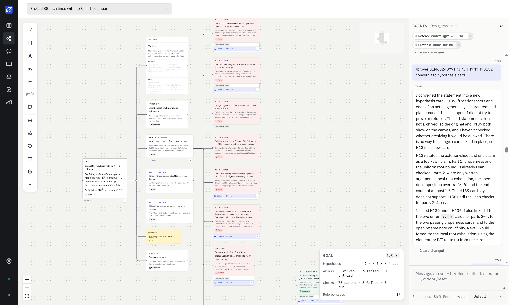

# Lemmata

A local research canvas where AI agents work on problems with you. A problem is a **goal** on a canvas; a **Prover**
agent splits it into **hypotheses** and proves or refutes them; a **Referee** checks the proofs. Everything lands on
the canvas as cards: proofs, counterexamples and Python/Lean checks. It runs locally, in the browser
or as a desktop app, using the Claude Code CLI for the agents.

<picture>
  <source media="(prefers-color-scheme: dark)" srcset="docs/images/canvas-dark.png">
  
</picture>

_A Prover (Claude Haiku) and a Referee (Codex) working on Erdős problem 588._

## What works today

- **Canvas:** goal, hypothesis, statement, note, Python and Lean cards with LaTeX, connected by typed edges
  (depends on, tested by, used by, checked by, refuted by).
- **Checks:** run Python and Lean cards locally and see the output on the card.
- **Agents:** enable Claude Code and Codex independently in Settings, pick a model per Prover or Referee (including different providers), and send `/prover goal` or `/referee H1` from the chat
  or from a card. Their cards appear on the canvas as they work.
- **Literature:** add an arXiv paper as a card, fetch its source and let agents read it section by section.
- **Progress:** hypothesis and goal statuses, plus a panel counting settled hypotheses, passed checks and referee issues.
- **Research memory:** agents save dead ends and facts per project and read them at the start of every run; you can pin,
  edit and add entries on the Memory page.

Plots, animations, exports and more toolkits are still to come. This is an early release: expect rough edges.

## Install

**Desktop app.** Download the installer for your system from the
[latest release](https://github.com/stepanvanzuriak/lemmata/releases/latest). It starts its own daemon and keeps projects
in `~/Lemmata` (set `LEMMATA_WORKSPACE` to use another folder). The first launch shows a short tour and checks which
tools it can find. See [docs/desktop.md](docs/desktop.md) for platform notes.

**Agents need the [Claude Code](https://docs.claude.com/en/docs/claude-code) CLI**, signed in once with `claude`. Python
checks use [uv](https://docs.astral.sh/uv/) and Lean checks use [Lean 4](https://lean-lang.org/); both are optional.

**From source** (browser): see [Development](#development).

Website: https://lemmata-app.vercel.app/

## Layout

| Path              | Role                                                            |
| ----------------- | --------------------------------------------------------------- |
| `apps/web`        | React UI (Vite, HeroUI, Tailwind)                               |
| `packages/daemon` | local HTTP API (Hono), bound to `127.0.0.1` and token-protected |
| `packages/core`   | SQLite data model and migrations (Drizzle ORM)                  |
| `packages/runner` | agent adapters (Claude Code) and token accounting               |
| `packages/shared` | types shared by the daemon and the web app                      |
| `apps/desktop`    | Tauri app: bundles the daemon on Node and the built web app     |
| `apps/site`       | the landing page (plain HTML and CSS, Vercel)                   |

## Development

Requires Node 22 or newer. Yarn 4 is committed in `.yarn/releases`, so any `yarn` on your PATH will use it.

```sh
yarn install
yarn dev
```

`yarn dev` starts the daemon on `127.0.0.1:4317` (workspace in `packages/daemon/.dev-workspace`, token `dev-token`)
and Vite on http://localhost:5173, which proxies `/api` to the daemon and adds the token.

| Command                        | Does                                                              |
| ------------------------------ | ----------------------------------------------------------------- |
| `yarn check`                   | Prettier check, ESLint, typecheck every workspace                 |
| `yarn test`                    | Vitest across all workspaces (`yarn test --project core` for one) |
| `yarn test:watch`              | Vitest in watch mode                                              |
| `yarn lint:fix`, `yarn format` | fix lint and formatting                                           |
| `yarn workspace core generate` | generate a migration after changing the schema                    |

A pre-commit hook runs lint-staged and the typecheck. See [CONTRIBUTING.md](CONTRIBUTING.md) before opening a pull
request.

## Releasing

Maintainers: see [docs/releasing.md](docs/releasing.md).

## Security

The daemon only listens on `127.0.0.1` and requires a per-launch token. To report a vulnerability, see
[SECURITY.md](SECURITY.md).

## License

[MIT](LICENSE)
